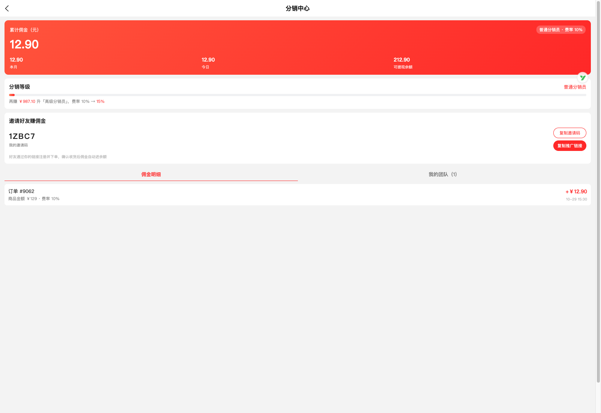
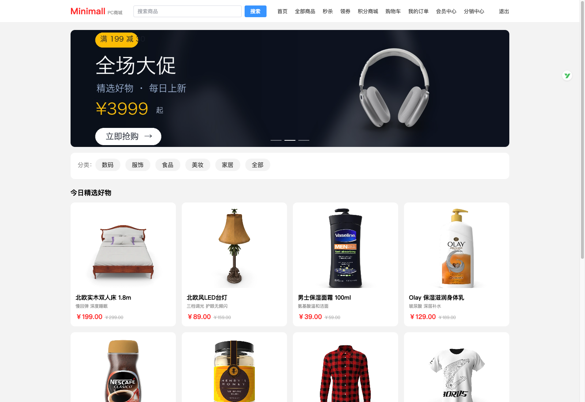
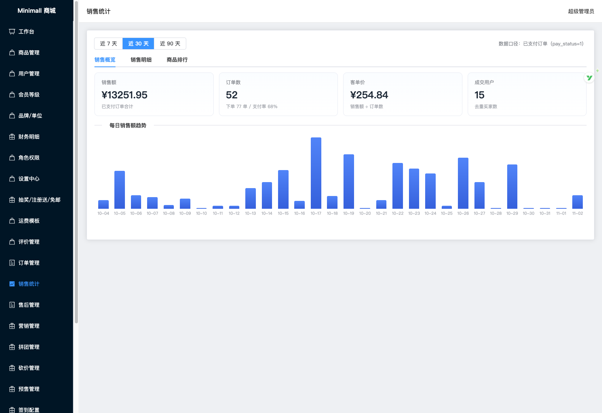
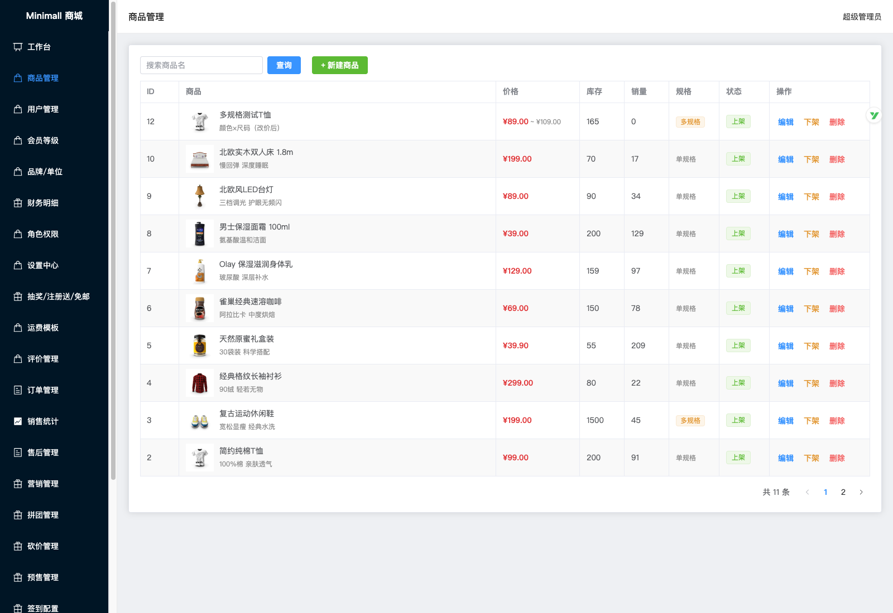
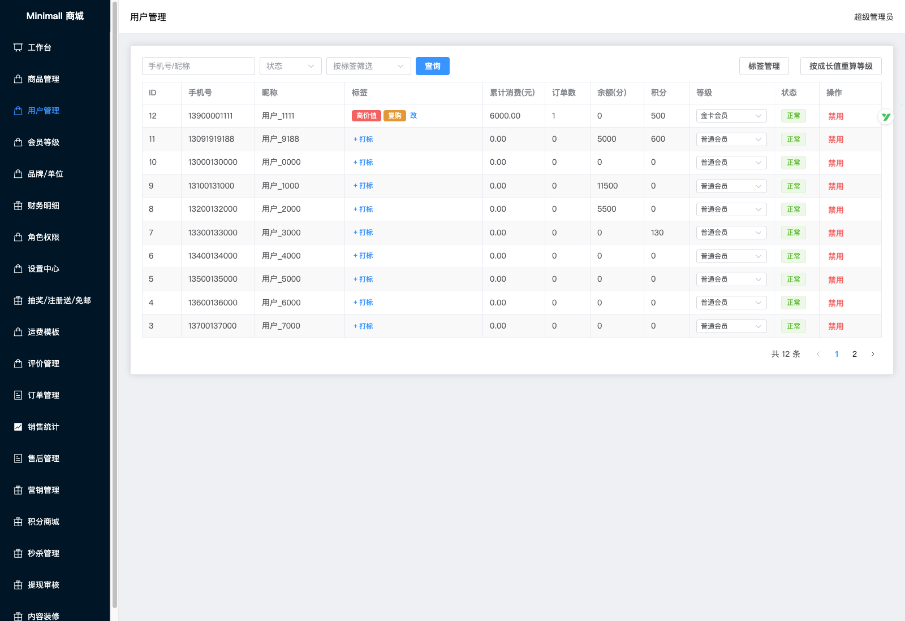
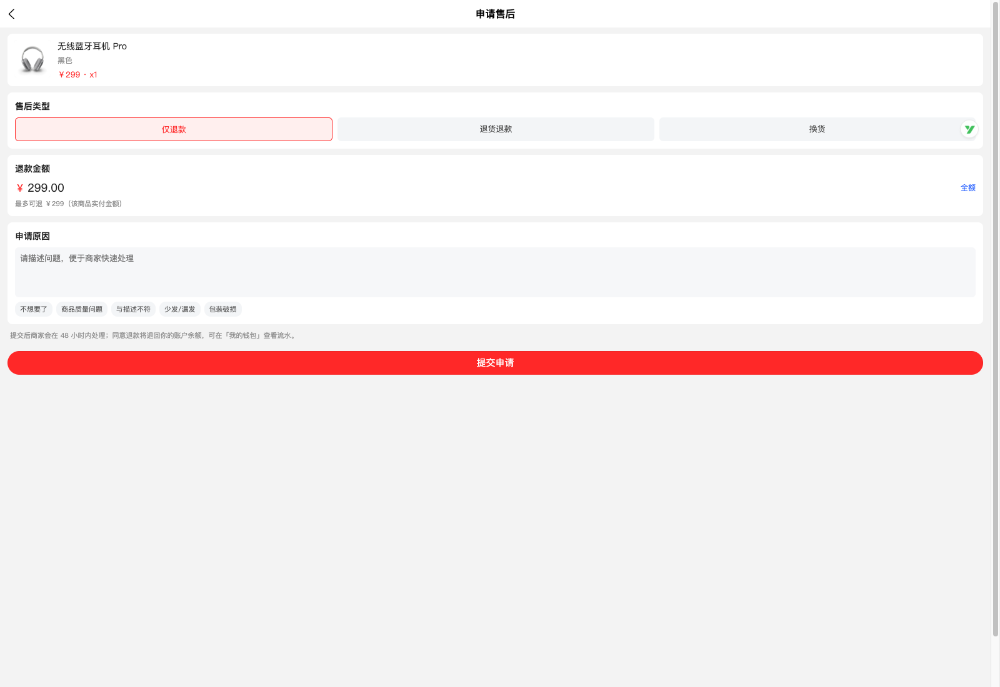

# Minimall · 单商户自营商城

一套**从零自研**的 Java 电商系统：后台管理 + PC 商城 + H5 商城 + 微信小程序，四端共用一套后端与一套 C 端代码。

业务覆盖面参考主流 B2C 商城的功能地图实现，**代码全部自研**（不复制第三方源码与素材），适合作为 Java 全栈学习项目、二开脚手架或方案演示。

<p align="left">
  
  
  
  
  
  
  
  
</p>

## 截图

| H5 商城 · 分销中心 | PC 商城 |
|---|---|
|  |  |

| 后台 · 销售统计 | 后台 · 商品与多规格 SKU |
|---|---|
|  |  |

| 后台 · 会员标签 | H5 · 申请售后 |
|---|---|
|  |  |

## 它能做什么

**交易主链路**：浏览 → 搜索 → 商品详情（多规格 SKU）→ 购物车 → 下单（会员价 / 满减 / 优惠券分层计算）→ 支付 → 发货 → 物流轨迹 → 收货 → 评价 → 售后（退款到余额并恢复库存）

**营销**：优惠券 / 满减 / 限时秒杀（Redis 原子库存）/ 拼团 / 砍价 / 预售（定金 + 尾款）/ 积分商城 / 每日签到 / 幸运抽奖 / 满额免邮 / 注册送

**会员与分销**：会员等级（成长值 = 累计实付，支付后自动升级）/ 会员标签分组 / 余额钱包（充值 / 提现审核 / 流水）/ 一级分销（邀请码、我的团队、按卖家等级结算佣金）

**后台**：工作台 / 商品（多规格）/ 订单（批量发货·改价·轨迹）/ 售后审核 / 销售统计 / 用户与标签 / 会员等级 / 品牌单位 / 运费模板 / 评价管理 / 营销配置（券·满减·拼团·砍价·预售·签到）/ 积分商城 / 秒杀 / 提现审核 / 财务明细 / 首页可视化装修 / 角色权限（菜单 + 按钮级 RBAC）/ 设置中心

## 技术栈

| 层 | 选型 |
|---|---|
| 后端 | Java 17 · Spring Boot 3.3 · MyBatis-Plus · Sa-Token（双体系：admin / user）· springdoc-openapi |
| 存储 | MySQL 8 · Redis 7（秒杀库存、会话、缓存） |
| C 端 | Vue 3 + uni-app（**一套代码编译 H5 与微信小程序**）|
| PC 端 | Vue 3 + Vite + Element Plus |
| 后台 | Vue 3 + Vite + Element Plus + Pinia |
| 部署 | Docker Compose（mysql + redis + server + nginx）|

## 规模

| 项 | 数量 |
|---|---|
| 接口 | **201**（C 端 85 / 后台 83 / 文档等） |
| 数据库表 | 65 |
| 后端 | 239 个 Java 文件 · 约 10.7k 行 |
| 页面 | H5 **31** · PC **15** · 后台 **20**（菜单 24 项含按钮级权限点）|

## 快速开始

### 一键起（推荐）

```bash
git clone https://github.com/aiden-yanzy/minimall.git minimall && cd minimall
cp .env.example .env      # 可选：改端口/口令（都有安全默认值，不改也能跑）
docker compose up -d      # mysql + redis + server + nginx，首次启动自动建表并灌种子数据
```

**开箱就有东西可看**：65 张表 + 演示数据（11 商品 / 31 SKU / 5 分类 / 优惠券 / 秒杀 / 拼团 / 砍价 / 预售 / 装修 JSON / 4 档会员等级 / RBAC 菜单角色），演示图片随仓库提供（`deploy/demo-upload`），不需要额外灌数据。

> 活动（秒杀/拼团/砍价/预售/满减/券）的起止时间在初始化脚本尾部会平移到**部署时刻**，所以任何时候 clone 下来活动都是「进行中」。

### 部署到云服务器（演示站）

```bash
# 在一台装了 Docker 的 Linux 服务器上（2G 内存起）
bash scripts/deploy-demo.sh            # 自动拉代码、生成 .env、起容器、等就绪、打印访问地址
bash scripts/deploy-demo.sh --port 8080 --reset
```

详见 [部署与运维](docs/03-部署运维.md)。

| 入口 | 地址 | 账号 |
|---|---|---|
| H5 商城 | http://localhost:18080/ | 种子账号 `13800138000 / 123456`，也可自行注册 |
| PC 商城 | http://localhost:18080/pc/ | 同上 |
| 后台管理 | http://localhost:18080/admin-web/ | `admin / admin123`（超管）· `operator / admin123`（运营，看权限差异用）|
| 接口文档 | http://localhost:18082/swagger-ui.html | — |

> 三端构建产物已随仓库提供（`deploy/www/`），开箱即可看到完整界面。要改前端看下面「本地开发」。

### 本地开发

```bash
# 后端：容器内 Maven 拉依赖不稳，走本机打包 + 薄运行镜像
cd server && mvn -q -DskipTests package && cd ..
docker build -f server/Dockerfile.runtime -t minimall-server:latest ./server
docker compose up -d --no-build server

# 后台
cd admin && npm i && npm run dev      # http://localhost:5173

# PC 商城
cd pc && npm i && npm run dev         # http://localhost:5175

# C 端（H5 / 微信小程序）
cd uniapp && npm i
npm run dev:h5             # H5 开发
npm run build:h5           # 构建 H5
npm run build:mp-weixin    # 构建微信小程序，产物 dist/build/mp-weixin
```

小程序导入、appid、域名白名单等细节见 [docs/小程序端说明.md](docs/小程序端说明.md)。

## 冒烟测试

一条命令验完主流程 + 并发安全，**25 项断言**：

```bash
python3 scripts/smoke.py                      # 只用标准库，系统 python3 即可
python3 scripts/smoke.py --skip-concurrency   # 无 docker 环境时跳过并发项
```

覆盖：健康检查 → 注册登录 → 领券 → 加购下单 → 支付 → 后台发货 → 物流轨迹 → 收货 → 评价 → 成长值累加 → 申请售后 → 后台同意退款 → 退款进余额 → **20 个并发打 5 件库存（必须恰好 5 单成功、库存归零且不为负）**。

任一步失败立即非 0 退出，可直接接 CI。

## 值得一看的设计点

| 主题 | 做法 |
|---|---|
| **防超卖** | 库存扣减用 `UPDATE ... SET stock = stock - n WHERE id = ? AND stock >= n`，扣不动即失败回滚。下单前的「查库存再判断」只用于快速失败，不作为并发保护 |
| **秒杀** | Redis 预扣库存 + DB 双写；key 缺失（新上架 / Redis 重启）按 DB 回源，扣成负数时校正重试，避免「明明有货永远抢不到」 |
| **超时关单** | `@Scheduled` 每分钟扫未支付订单（普通 30min / 秒杀 5min），用 CAS `WHERE order_status = 0` 抢占状态，避免误杀刚支付的订单；关单同时恢复库存、回补秒杀库存、退回优惠券 |
| **售后** | 同意退款 → 退到余额并写账户流水 → 恢复库存（秒杀单回补秒杀库存）→ 标记订单行已售后 |
| **会员成长值** | 成长值 = 累计实付，支付成功即时累加并按门槛重算等级；等级折扣参与下单时的价格分层计算 |
| **分销** | 邀请码加盐编码（避免 base36 短码可枚举）；注册带 `inviteCode` 自动绑定；收货后按**卖家本人累计佣金**匹配到的等级费率结算 |
| **权限** | `/admin/auth/me` 下发权限码，前端菜单与按钮按权限渲染，后端 `@SaCheckPermission` 兜底；admin 与 user 是两套 Sa-Token 体系（混用会导致 401） |
| **首页装修** | 轮播 / 宫格 / 商品区标题存 JSON，后台可视化编辑 + 手机实时预览，服务端做结构校验（避免坏 JSON 把 C 端首页搞挂） |

## 目录结构

```
minimall/
├── server/                  # Spring Boot 后端（按业务域分包）
│   └── src/main/resources/sql/minimall-init.sql   # 全量建表 + 种子数据
├── uniapp/                  # C 端：Vue3 + uni-app（H5 / 微信小程序）
├── pc/                      # PC 商城端
├── admin/                   # 后台管理端
├── deploy/                  # nginx 配置 + 三端构建产物（www/）
├── scripts/                 # 启动、演示数据、冒烟测试
├── docs/                    # 技术方案 · 接口概览 · 部署运维 · 演示脚本 · 小程序说明
├── docker-compose.yml
└── .env.example             # 端口 / 口令 / JWT 密钥（复制成 .env 使用）
```

## 文档

- [技术设计方案](docs/01-技术设计方案.md)
- [接口概览](docs/02-接口概览.md)
- [部署与运维](docs/03-部署运维.md)
- [演示脚本（5 分钟走完）](docs/04-演示脚本.md)
- [小程序端说明](docs/小程序端说明.md)

## 上线前还需要补

这些都需要外部资质或第三方账号，仓库里只留了接口与占位：

- **真实支付**：微信 / 支付宝 SDK + 商户号 + 回调验签（当前 `/shop/pay/mock` 模拟直通，回调接口已按签名结构预留）
- **小程序登录**：`wx.login` → `code2Session` 换 openid（当前手机号 + 密码）
- **短信验证码**：注册与找回密码
- **对象存储**：OSS / COS 替换本地 upload 卷
- **域名与备案**：小程序要求 https + 已备案域名 + 后台白名单
- **自动化测试**：目前只有端到端冒烟脚本，缺单元测试与 CI 流水线

## 免责声明

- 本项目为**学习与技术演示**用途；业务功能范围参考了公开电商产品的功能地图，**代码与素材均自行实现**，不包含第三方授权代码。
- 仓库内的账号口令、JWT 密钥均为**本地演示默认值**，公网部署前请务必修改（见 `.env.example`）。
- 演示商品图片来自公开图库，仅用于展示。

## License

[MIT](LICENSE)
